

# Noe P. Cagomoc

### Networks & systems. IT support & automation.

I’ve worked in IT for six years, from user support to managing servers and networks. I also build tools that cut down repetitive work.

  

## What I do

ICT Administration Supervisor / Database & Server Admin at Leonio Group.

- Windows and Linux administration, Microsoft 365, databases, shared storage, and backups.
- Network deployment, configuration, security, and troubleshooting across offices and remote sites.
- Technical support, endpoint protection, CCTV, biometrics, and access-control systems.
- Requirements, deployment plans, vendor coordination, site work, and technical documentation.

AI Engineer Intern at [Clauto](https://clauto.io/), 2026. Learned agentic programming with Codex, Claude Code, OpenCode and harness tools such as Oh My OpenCode, including how different models work and when to use them.

## Projects

| Project | What it does |
| --- | --- |
| Server monitoring and report automation | Monitor server health with Zabbix and Grafana and generate reports for the ICT team. |
| Network Report Automation (UniFi) | Collect UniFi network data through its API and generate recurring network reports. |
| Translift CMS file uploader | A companion document and photo uploader that supports the existing legacy CMS workflow. |
| Python support automation | Application installation automation for recurring technical support and workstation setup tasks. |
| [Buseng Chronicles](https://github.com/npcagomoc-del/buseng-chronicles) | A Filipino meme-inspired game for Android and PC, developed as a personal project. |
| [Libre Trading Journal](https://github.com/npcagomoc-del/libre-trading-journal) | Based on Trading-Journal-AI by Simon / Tape to Edge (MIT). The project focuses on local journaling, optional AI provider support, and backup and restore workflows. |

[More projects and experience](https://npcagomoc-del.github.io/#work)

## Toolkit

### Systems & applications

  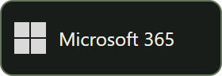  

Windows Server, Linux, Microsoft 365, Database administration, Synology NAS, Docker, Backup operations.

### Networks & security

 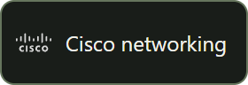  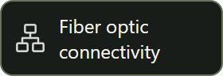

UniFi, Cisco networking, LAN / WAN, Fiber optic connectivity, Network troubleshooting.

### Support, CCTV & access systems

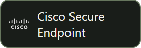   

Technical support, Cisco Secure Endpoint, Hikvision CCTV, ZKTeco, Anviz, IT asset management.

### Automation & development

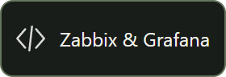  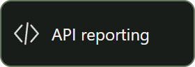   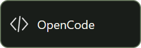 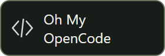 

Zabbix & Grafana, Python, API reporting, OpenAI Codex, Claude, OpenCode, Oh My OpenCode, Git & GitHub.

### Project management

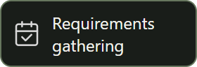  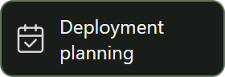 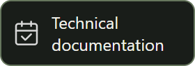

Requirements gathering, Vendor coordination, Deployment planning, Technical documentation.

## Certifications

- Cisco Certified Network Associate
- AWS Certified Solutions Architect – Associate
- Microsoft Certified: Azure Fundamentals
- Certified in Cybersecurity (CC)

I love learning and putting new skills to work.
